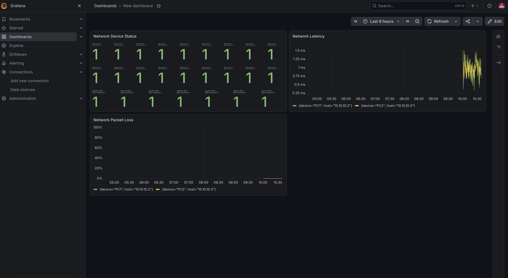

# Network Health Checker


A Python-based network monitoring project that checks device availability, measures network performance, and visualises monitoring metrics using Prometheus and Grafana.

Developed and tested in a Linux environment with a GNS3 virtual network lab.
## Grafana Dashboard


## Features

- **Device Availability Monitoring:** Checks whether configured devices are reachable.
- **Latency Monitoring:** Measures minimum, average, and maximum round-trip time (RTT).
- **Packet Loss Monitoring:** Calculates packet loss percentage.
- **Status Change Alerts:** Reports when a device becomes unavailable or recovers.
- **Performance Alerts:** Identifies latency above a configurable threshold.
- **Health Reports:** Generates JSON and CSV reports.
- **Historical Results:** Records monitoring results over multiple checks.
- **Prometheus Metrics:** Exposes device availability, latency, and packet loss metrics.
- **Grafana Dashboard:** Visualises device status, latency, and packet loss.
- **Automated Testing:** Uses pytest and GitHub Actions for continuous integration.

## Technologies

- Python 3
- Prometheus
- Grafana
- Docker Compose
- GNS3
- Linux and Bash
- pytest
- Git and GitHub

## Architecture

1. Virtual devices run in a GNS3 lab.
2. The Python application checks device connectivity and performance.
3. The application exposes metrics on port `8000`.
4. Prometheus collects metrics every five seconds.
5. Grafana visualises the metrics in a dashboard.

## Project Structure

```text
network-health-checker/
├── devices.json
├── src/
│   ├── main.py
│   ├── connectivity.py
│   ├── availability.py
│   ├── performance.py
│   └── metrics.py
├── monitoring/
│   ├── prometheus/
│   │   └── prometheus.yml
│   └── grafana/
│       └── provisioning/
├── reports/
├── docker-compose.yml
└── .gitignore
```

## Requirements

- Python 3
- Docker Engine
- Docker Compose
- GNS3 or another environment containing reachable test devices

## Installation

Clone the repository:

```bash
git clone https://github.com/shokoohisaeede/network-health-checker.git
cd network-health-checker
```

Create and activate a virtual environment:

```bash
python3 -m venv .venv
source .venv/bin/activate
```

Install the Python dependencies:

```bash
pip install prometheus-client pytest
```

Configure the devices in `devices.json` using the IP addresses in your lab.

## Running the Monitoring Application

Start the monitoring application:

```bash
python src/main.py --interval 10
```

The application checks devices every ten seconds and exposes Prometheus metrics on port `8000`.

View the metrics locally:

```bash
curl http://localhost:8000/metrics
```

## Starting Prometheus and Grafana

Create a local `.env` file containing your Grafana credentials. Do not commit this file to GitHub.

Start the monitoring services:

```bash
docker compose up -d
```

Check service status:

```bash
docker compose ps
```

Open the interfaces:

- Prometheus: http://localhost:9090
- Grafana: http://localhost:3000

The Grafana dashboard visualises:

- Device availability
- Network latency in milliseconds
- Packet loss percentage

Keep the Python monitoring application running so Prometheus can continue collecting metrics.

## Running Tests

Activate the virtual environment and run:

```bash
python -m pytest -v
```

## Lab Environment

The project has been tested using GNS3 virtual PCs connected through a virtual switch. This controlled environment makes it possible to test connectivity, observe packet loss, and measure latency.

## Future Improvements

- SNMP-based monitoring for network equipment
- Configurable alert thresholds and notification integrations
- Additional device and protocol support
- More advanced performance and availability dashboards

## Author

Network Engineering and Python Networking Project

GitHub: https://github.com/shokoohisaeede
